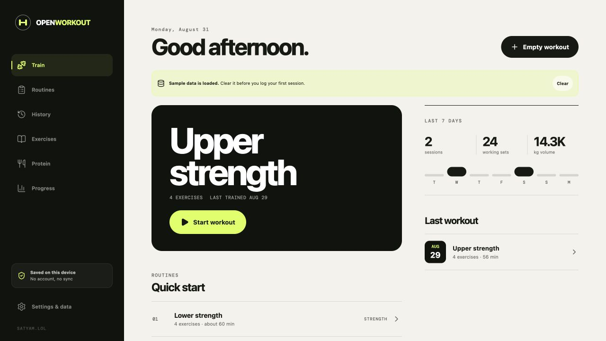

# OpenWorkout

A mobile-first, private workout tracker that runs entirely in the browser. Workouts, routines, measurements, custom exercises, and progress photos stay on the current device and can be exported as JSON or CSV. Finished sessions can also be turned into a 1080 × 1920 story card and shared through the device share menu or downloaded as a PNG.

Every exercise detail includes a responsive front/back muscle map. Primary and assisting regions are derived from the exercise library and rendered locally with the MIT-licensed `react-muscle-highlighter` SVG paths; see [public/THIRD_PARTY_NOTICES.txt](./public/THIRD_PARTY_NOTICES.txt). The notice is copied into every production build.

**[Try OpenWorkout](https://workout.satyam.lol/)**

## Run locally

    npm install
    npm run dev

Create a production build with:

    npm run build

The deployable static site is written to the dist directory.

## Cloudflare Pages

- Framework preset: **Vite**
- Build command: npm run build
- Build output directory: dist
- Root directory: repository root

After the first deployment, add the chosen satyam.lol subdomain in **Workers & Pages → Custom domains**. The included public/_headers file adds privacy/security headers and correct cache behavior for the service worker and fingerprinted assets.

## Automatic deployment at workout.satyam.lol

The included `.github/workflows/deploy-pages.yml` workflow mirrors the Hear deployment. Every push to `main` builds the app and deploys `dist` to a Cloudflare Pages project named `openworkout`.

One-time setup:

1. Create the `openworkout` Pages project in the same Cloudflare account that manages `satyam.lol`.
2. Add `CLOUDFLARE_ACCOUNT_ID` and `CLOUDFLARE_API_TOKEN` to the GitHub repository's Actions secrets. The token needs Cloudflare Pages edit permission.
3. In the Pages project's **Custom domains** settings, attach `workout.satyam.lol`.
4. Push to `main`, or run **Deploy OpenWorkout to Cloudflare Pages** manually from the Actions tab.

Cloudflare keeps the custom domain attached to the Pages project, so subsequent successful workflow runs update the subdomain automatically.

## GitHub Pages

The Vite build uses relative asset paths, so it works on both a custom subdomain and a repository subpath. Publish dist with the GitHub Pages workflow or deployment action of your choice. The app uses in-page state instead of URL routes, so no SPA rewrite rule is required.

## Local-first behavior

- No accounts, API server, analytics, or runtime third-party requests
- Automatic local persistence and active-workout recovery
- JSON backup/restore, including routines and private progress data
- Flat CSV workout export for Excel, Numbers, or Google Sheets
- Installable PWA shell with offline asset caching

Browser storage belongs to the current browser profile and domain. Export a backup before clearing site data, changing domains, or moving to a new phone.
